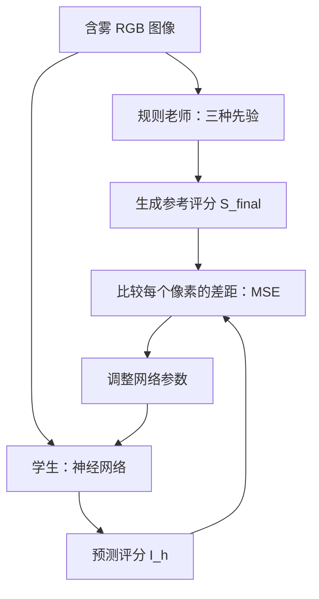

# 从零理解这个项目的雾密度分析

更新于 2026-10-20。以下先讲直觉，再对应到实际代码。

## 1. 我们想让电脑判断什么？

给电脑一张含雾遥感照片，让它给每个位置一个 0～1 的评分，再画成一张灰度图。按项目约定，评分越大，表示这个位置更符合我们定义的雾特征；灰度图里通常越亮。

例如一张图有 256×256 个像素，输出也有 256×256 个评分。输入有红、绿、蓝三个通道，输出只有一个评分通道。这里的“密度图”是空间分布图。

**0.8 不是“80% 是雾”，也不是能见度、PM2.5 或真实雾浓度。** 这是本项目规则定义出来的分数，尚未经过物理标定。

## 2. 为什么能从照片中猜到雾？

雾会散射光线。常用的成像模型写成：

```text
I(x) = J(x) × t(x) + A × (1 - t(x))
t(x) = exp(-β × d(x))
```

- `I`：相机拍到的含雾图。
- `J`：希望看到的清晰场景。
- `t`：透射率，表示场景光有多少能到达相机。
- `A`：大气散射光。
- `β`：散射系数；`d`：场景到相机的距离。

直觉上，雾越重或传播距离越长，场景细节越不明显，画面更容易发白、反差变小、颜色变淡。但距离、物体颜色和光照也会产生相似变化，所以单张照片的判断存在歧义。这个物理背景可参考 [暗通道先验原始论文页面](https://people.csail.mit.edu/kaiming/cvpr09/index.html)。

当前代码没有反解 `β`，也没有完整估计 `A`、`t` 或恢复清晰图 `J`；只是借用了几种图像特征来构造参考评分。

## 3. 没有人工标好的雾密度答案，网络怎么学？

当前方案先用规则给图片生成一份“参考答案”，称为**伪标签**。它可以自动计算，但不等同于真实测量。

可以把整个训练理解为：老师先按固定规则判卷，学生学习模仿老师。这里老师是 `PhysicalPriorModule`，学生是 `HazeDensityNet`。



清晰配对图虽然存在于数据集目录里，当前雾密度训练没有用它来计算损失；`transpng`、`airpng` 和近红外图也未作为监督使用。因此，不能把“用了成对去雾数据集”理解成“用了真实密度标签”。

## 4. 规则老师怎样生成参考答案？

对应代码是 `src/models/haze_density/physical_prior.py`。在裁剪/缩放后的图像上计算：

### 第一步：暗通道，看局部还有没有很暗的颜色

在默认 15×15 的邻域里，从所有像素、所有 RGB 通道中取最小值：

```text
D(x) = 邻域内所有 RGB 数值的最小值
```

许多无雾室外区域至少有一个很暗的颜色通道；雾的散射光可能把这些暗值抬高。因此较亮的暗通道可作为雾线索。白色屋顶、雪地等也会抬高暗通道，这就是误判来源之一。当前只是使用这一线索，并非完整复现原始暗通道去雾算法。

### 第二步：局部对比度，看细节有没有被“冲淡”

代码先将 RGB 转成灰度 `G`，再比较当前像素与邻域均值：

```text
G = 0.299R + 0.587G_channel + 0.114B
C(x) = |G(x) - 局部灰度均值|
C_hat = 1 - 归一化(C)
```

差异小的区域比较平坦，参考雾评分倾向更高。这里计算的是局部均值残差的绝对值，不是方差或标准差。水面、平整地面即使无雾，也可能被赋高分。

### 第三步：颜色差异，看颜色是否趋于灰白

```text
K(x) = |R - G| + |R - B|
K_hat = 1 - 归一化(K)
```

颜色通道接近时，这一项的雾评分较高。它没有直接比较含雾图与清晰图，也没有估计完整的色偏；灰色建筑本身就可能得到高分。

### 第四步：把线索合起来

每张图、每个通道分别在整个高宽范围内做 min-max 归一化：

```text
N(X) = (X - 本图最小值) / (本图最大值 - 本图最小值 + 1e-8)
D_hat = N(D)
S = 0.5 × D_hat + 0.3 × C_hat + 0.2 × K_hat
S_hat = S^1.5
```

这组权重和指数是当前代码的固定设定，不代表已经经过最优性验证。代码注释称其来自申报书，但仓库没有申报书 PDF，本次无法核对原文。

注意 `S^1.5` 在 0～1 之间会压低中低分。例如 `0.25^1.5 = 0.125`。它改变分数分布，并非把所有分数都放大。

### 第五步：用引导滤波平滑

用原图的灰度结构来引导评分图平滑，得到 `S_final`。直觉是减少碎小噪声，同时尽量保留与图像结构相关的边缘；它不会自动识别什么才是真雾。原理参考 [Guided Image Filtering 作者页面](https://people.csail.mit.edu/kaiming/eccv10/index.html)。

当前使用半径 15、正则项 0.01，输出裁剪到 0～1。局部均值计算仍采用零填充，边缘可能有偏差，检查结果时要留意。

## 5. 神经网络具体做什么？

模型结构在 `src/models/haze_density/haze_density_net.py`：

```text
含雾 RGB 图像 [B, 3, H, W]
  → Encoder：提取特征，空间尺寸减半
  → 三个并行分支：膨胀率 2、3、4，从不同邻域范围看图像
  → 每个分支：SDRB → 两个残差块 RB → ECA 通道注意力
  → 拼接并融合三路特征
  → Decoder：上采样回原尺寸，再用 Sigmoid 输出评分
雾感图 [B, 1, H, W]
```

`B` 是一次处理几张图；`H、W` 是图像高宽。默认基础通道 32，编码后的特征通道是 64。当前编码器只有一次空间下采样，不能按旧 YAML 的 `encoder_depth: 4` 来理解；该未生效字段已移除。

多尺度分支帮助同时观察小范围和大范围变化；残差连接帮助信息和梯度传播；ECA 为不同特征通道调整权重。这些是网络设计，是否带来收益需要消融实验验证。

训练的误差是：

```text
Loss = 所有像素 (预测评分 - 参考评分)^2 的平均值
```

例如老师给某个像素 0.6，网络预测 0.4，这个像素贡献 `(0.4-0.6)^2=0.04`。训练反复修改网络参数，减小平均误差。规则老师本身不随训练更新。

## 6. 训练、验证、测试、推理有什么不同？

| 环节 | 通俗理解 | 当前项目里做什么 |
|---|---|---|
| 训练 | 做练习、改答案 | 用 train 图像生成伪标签，反向传播更新参数 |
| 验证 | 用另一套题检查进步 | 用 val 选择误差最低的 checkpoint，不更新参数 |
| 测试 | 方案确定后的考试 | 用官方 test 计算整体和各子集指标 |
| 推理 | 实际使用 | 新 RGB 图像输入已训练网络，直接输出评分图 |

验证集从官方训练图片中固定划出约 10%，测试集保留官方划分。训练时随机裁剪和翻转；验证/测试时确定性缩放。几何变换后才生成先验标签。

当前网络对偶数高宽与现有 256/512 流程更合适；任意尺寸整图推理、滑窗拼接还需要额外适配和验证。

## 7. 结果好看，或者指标很好，能说明什么？

评估脚本比较的是**网络预测与规则伪标签**：

| 指标 | 大致含义 |
|---|---|
| MAE | 每个像素平均偏离参考分数多少，越小越接近 |
| RMSE | 更强调大误差，越小越接近 |
| Pearson | 预测与参考分数的变化是否相关，越接近 1 越正相关；常数图时可能无定义 |

MAE=0.08 可以理解为“相对这套参考评分，平均差约 0.08”；不能写成“真实雾浓度误差只有 8%”，也不能直接换成检测准确率。

当前有三条需要牢记的限制：

1. **老师也可能错。** 白屋顶、裸地、雪地、水面、云和阴影可能干扰这些规则。学生学得像老师，不能独立证明物理判断正确。
2. **分数具有图像内相对性。** 每图 min-max 会丢掉部分绝对幅值；不同图、不同裁剪范围、不同分辨率的平均评分不能直接作为统一雾等级标尺。均匀图尤其值得单独检查。
3. **网络是否值得训练还要证明。** 既然规则本身能生成图，应比较直接规则与网络的速度、稳定性、对独立标签或下游任务的效果。不能预先声称网络更快或更准。

Decoder 输出前还有单通道 InstanceNorm，这会约束每张图的输出分布，对整图绝对浓度表达的影响尚未做消融。

## 8. 它在整个科研项目里处于哪一步？

雾感图可以成为后续模型的提示：哪些位置可能受雾影响较大，让特征网络尝试有针对性地调整。当前已有两种接法：把 RGB 和密度图拼成四通道，或用密度图参与特征注意力。

这些接法目前是集成原型。现有代码没有完成真实去雾、超分辨率或开放词汇目标检测；把密度图接进去不等于任务性能已经提高。

汇报时可以这样表述：

> 我们先利用暗通道、局部灰度差和 RGB 颜色差构建相对雾感伪标签，再用多尺度残差注意力网络学习预测该分布。目前已实现雾密度模块及集成原型；其物理有效性与下游任务收益仍需独立标签和消融实验验证。

准备动手时继续看 [操作指南](haze_density_user_guide.md)。本次修复及旧 checkpoint 的限制见 [审查记录](../project_review.md)。
