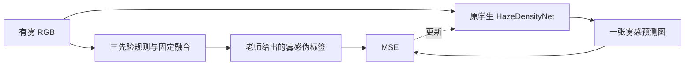
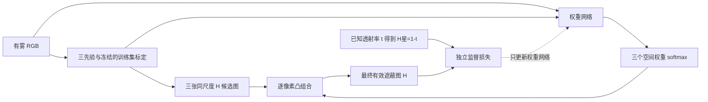

# 原学生模型与动态权重模型的关系

## 先回答“有没有把原学生改成估计权重”

2026-11-01 的第一轮 v2 **没有复用原学生结构**：新增的是 `ConvexFusion(mode='dynamic')`，一个 3683 参数的小网络。旧老师、旧学生与旧权重保持原样。

本次继续探索新增 `StudentWeightGate`，**复用原学生的特征提取结构，并将输出职责改为三张融合权重图**。这是独立的实验版本，文件为 `src/models/haze_density/student_weight_gate.py`。没有覆盖旧 `HazeDensityNet`，也没有默认把它换成新的主模型。

## 原流程：拟合老师给出的评分

原学生学习复现老师的结果。老师判断错时，旧监督并不能自行纠正。这属于物理先验伪标签监督，不能因为没有人工标注就称完全无监督。

## 当前研究流程：独立答案监督融合选择

三先验在这里提供可供选择的估计，不再垄断监督答案。网络通过最终融合误差学习如何选择；不需要人为指定某个区域的“正确权重”。能产生相同融合结果的权重可能不唯一，因此不能将权重当作物理可信度真值。

严格说，新版本应称“三先验候选估计 + 门控融合”，继续叫老师学生容易误解。学习目标来自已知合成透射率，因此本轮属于**合成目标监督训练**，不能宣称完全无监督。

独立答案能帮助网络降低某个错误先验的权重，但无法让凸组合超出三候选的最小值和最大值。如果三者都把白屋顶估高，且正确值低于三者，权重网络也无解。这正是离线 oracle 和困难区域诊断要检查的边界，不是增加训练轮数就能消失的问题。

## 重构保留和替换了哪些部分

| 部分 | 本次 StudentWeightGate |
|---|---|
| RGB Encoder | 复用原 Encoder 类，base_channels=32 |
| 三路膨胀卷积、多尺度与注意力 | 复用原 ParallelMultiScaleFeatureExtractor |
| 特征融合 | 复用原 FusionModule |
| 解码前两段特征操作 | 延续原转置卷积、归一化和卷积结构 |
| 原单通道密度 Conv、输出 InstanceNorm、Sigmoid | 新版本不使用；原文件不改 |
| 新输出头 | 拼接特征与 RGB/候选图/原始强度，输出三通道 logits，再 softmax |
| 最终密度/遮蔽结果 | 三张冻结候选图的加权和，不允许自由残差修正 |
| 参数初始化 | 新任务从头训练，不加载旧伪标签学生权重 |

从头训练的理由：旧权重的数据划分按文件随机进行，无法核验与本轮真实外部组的地理隔离，直接加载会损害外部评价的公平性。另外，旧权重的优化目标本来就不同。**复用结构与复用训练好的权重是两件事。**

保留特征层 InstanceNorm，并不等于把绝对强度在整个新模型中丢掉：RGB、标定候选图和未逐图归一化的原始强度有直接通向权重头的路径。输出端不做逐图归一化。

重构后的网络为 868275 参数，与前轮小门控不是同一个容量。小门控温度对照与重构学生使用相同温度、初始化权重、独立目标、候选图、训练/开发场景、优化器和训练轮数；它们的主要差异是上下文特征结构和容量。本轮不能进一步把两者的差异拆分成“究竟是哪一个原模块贡献”。

## 结论边界

单块拟合只回答网络有没有能力优化凸融合，不证明对未见场景有效。新模型只有在冻结后的新原始场景、亮度和大气光条件下表现稳定，且优于优化固定融合，才能支持其用途。原始真实场景的可靠绝对监督、地理来源和成像域仍有限，不能凭程序化场景成功宣布真实遥感应用已经解决。

继续探索记录保存在 `experiments/v2_investigation_20261101`，与第一轮 `experiments/v2_20261101` 隔离。
