# 独立雾响应评测报告

> Git 归档说明：数值仍覆盖全部 128 个样本和 3 种方法；按固定场景/模式覆盖保留 12 张对比图及全部 16 张排序曲线，规则见 [精选实验索引](../../../../README.md)。完整图版报告与未选图片保留在云实例上。

执行状态：PASS；数据性质：real_clear_remote_sensing；划分：test。

PASS 表示评测实现成功运行，不代表算法已经通过科学有效性验证。缺少预注册验收阈值时，以下指标均为描述性结果。

## 方法可用性

| 方法 | 状态 | 说明 |
|---|---|---|
| dcp | PASS | 独立真值评测已执行 |
| prior | PASS | 独立真值评测已执行 |
| student | PASS | 独立真值评测已执行 |

## 场景宏平均

| 方法 | 地物 | 场景组数 | 排序准确率 | 平局率 | Spearman | 单调性违反率 | 无雾响应 | 空间区域 Spearman |
|---|---|---:|---:|---:|---:|---:|---:|---:|
| dcp | ALL | 1.0000 | 1.0000 | 0.0000 | 1.0000 | 0.0000 | 0.1349 | 0.9593 |
| dcp | bare_soil | 1.0000 | 1.0000 | 0.0000 | 1.0000 | 0.0000 | 0.2845 | 0.9499 |
| dcp | urban | 1.0000 | 1.0000 | 0.0000 | 1.0000 | 0.0000 | 0.1802 | 0.9379 |
| dcp | vegetation | 1.0000 | 1.0000 | 0.0000 | 1.0000 | 0.0000 | 0.0194 | 0.9794 |
| dcp | water | 1.0000 | 1.0000 | 0.0000 | 1.0000 | 0.0000 | 0.0554 | 0.9700 |
| prior | ALL | 1.0000 | 0.2188 | 0.0000 | -0.5562 | 0.7812 | 0.3980 | 0.9558 |
| prior | bare_soil | 1.0000 | 0.0000 | 0.0000 | -1.0000 | 1.0000 | 0.5431 | 0.9363 |
| prior | urban | 1.0000 | 0.0000 | 0.0000 | -1.0000 | 1.0000 | 0.4707 | 0.9323 |
| prior | vegetation | 1.0000 | 0.5000 | 0.0000 | 0.0000 | 0.5000 | 0.2982 | 0.9789 |
| prior | water | 1.0000 | 0.3750 | 0.0000 | -0.2250 | 0.6250 | 0.2799 | 0.9757 |
| student | ALL | 1.0000 | 0.9812 | 0.0000 | 0.9812 | 0.0469 | 0.4890 | 0.9532 |
| student | bare_soil | 1.0000 | 0.9750 | 0.0000 | 0.9750 | 0.0625 | 0.5056 | 0.9353 |
| student | urban | 1.0000 | 1.0000 | 0.0000 | 1.0000 | 0.0000 | 0.4952 | 0.9303 |
| student | vegetation | 1.0000 | 0.9750 | 0.0000 | 0.9750 | 0.0625 | 0.4747 | 0.9769 |
| student | water | 1.0000 | 0.9750 | 0.0000 | 0.9750 | 0.0625 | 0.4804 | 0.9700 |

各场景内先平均、再对场景组宏平均。详见 `condition_strata.csv` 的地物×大气光×亮度分层及 `results.json` 的有效场景数。未知地物不冒充城市/植被/水体/裸地。

无雾响应阈值仅为各方法内部诊断，不是跨方法校准过的 FPR；预测与透射率没有直接计算物理 MAE。常量真值的空间相关为 N/A，常量预测的相关也为 N/A。

## 典型排序失败候选

- prior / G_test_1053，A=[0.75, 0.8, 0.9]，brightness=1.0：accuracy=0.000，ties=0.000，strong−clear=-0.0448。可检验的解释包括反射率/颜色混淆与逐图归一化丢失幅值；当前实验未做因果归因。
- prior / G_test_1053，A=[0.75, 0.8, 0.9]，brightness=0.7：accuracy=0.000，ties=0.000，strong−clear=-0.0436。可检验的解释包括反射率/颜色混淆与逐图归一化丢失幅值；当前实验未做因果归因。
- prior / G_test_1072，A=[0.75, 0.8, 0.9]，brightness=1.0：accuracy=0.000，ties=0.000，strong−clear=-0.0520。可检验的解释包括反射率/颜色混淆与逐图归一化丢失幅值；当前实验未做因果归因。
- prior / G_test_1072，A=[0.75, 0.8, 0.9]，brightness=0.7：accuracy=0.000，ties=0.000，strong−clear=-0.0489。可检验的解释包括反射率/颜色混淆与逐图归一化丢失幅值；当前实验未做因果归因。
- prior / G_test_1126，A=[1.0, 1.0, 1.0]，brightness=1.0：accuracy=0.000，ties=0.000，strong−clear=-0.1165。可检验的解释包括反射率/颜色混淆与逐图归一化丢失幅值；当前实验未做因果归因。
- prior / G_test_1126，A=[1.0, 1.0, 1.0]，brightness=0.7：accuracy=0.000，ties=0.000，strong−clear=-0.1134。可检验的解释包括反射率/颜色混淆与逐图归一化丢失幅值；当前实验未做因果归因。
- prior / G_test_1126，A=[0.75, 0.8, 0.9]，brightness=1.0：accuracy=0.000，ties=0.000，strong−clear=-0.1889。可检验的解释包括反射率/颜色混淆与逐图归一化丢失幅值；当前实验未做因果归因。
- prior / G_test_1126，A=[0.75, 0.8, 0.9]，brightness=0.7：accuracy=0.000，ties=0.000，strong−clear=-0.1960。可检验的解释包括反射率/颜色混淆与逐图归一化丢失幅值；当前实验未做因果归因。

## 空间响应失败候选

- student / G_test_1328__a1_b0__blob：区域 Spearman=0.8059，重雾−轻雾响应差=0.2557。负相关/负差表示该样例上与已知退化方向冲突；具体原因还需受控消融。
- prior / G_test_1328__a1_b0__blob：区域 Spearman=0.8147，重雾−轻雾响应差=0.3348。负相关/负差表示该样例上与已知退化方向冲突；具体原因还需受控消融。
- dcp / G_test_1328__a1_b0__blob：区域 Spearman=0.8353，重雾−轻雾响应差=0.2712。负相关/负差表示该样例上与已知退化方向冲突；具体原因还需受控消融。
- student / G_test_1328__a0_b0__blob：区域 Spearman=0.8471，重雾−轻雾响应差=0.2897。负相关/负差表示该样例上与已知退化方向冲突；具体原因还需受控消融。
- prior / G_test_1328__a0_b0__blob：区域 Spearman=0.8618，重雾−轻雾响应差=0.3740。负相关/负差表示该样例上与已知退化方向冲突；具体原因还需受控消融。
- prior / G_test_1126__a1_b0__blob：区域 Spearman=0.8647，重雾−轻雾响应差=0.3272。负相关/负差表示该样例上与已知退化方向冲突；具体原因还需受控消融。
- prior / G_test_1126__a1_b1__blob：区域 Spearman=0.8647，重雾−轻雾响应差=0.3321。负相关/负差表示该样例上与已知退化方向冲突；具体原因还需受控消融。
- student / G_test_1126__a1_b0__blob：区域 Spearman=0.8647，重雾−轻雾响应差=0.3172。负相关/负差表示该样例上与已知退化方向冲突；具体原因还需受控消融。

## 固定尺度可视化

所有预测图固定显示范围 0～1；透射率 t 越小表示雾越重。秩残差是无量纲空间诊断，不是真实透射率误差。

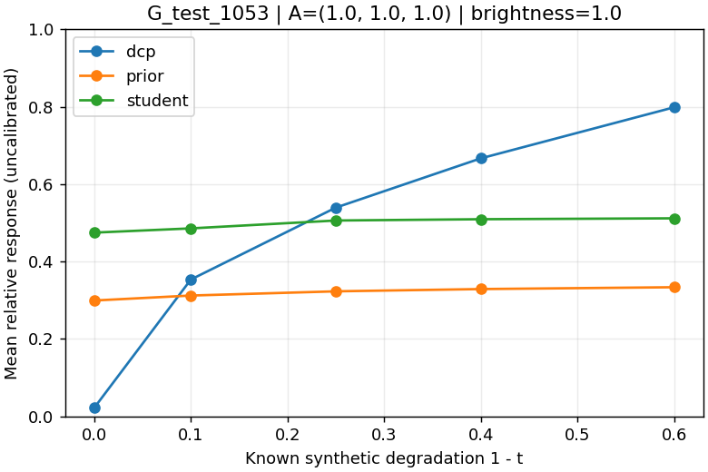
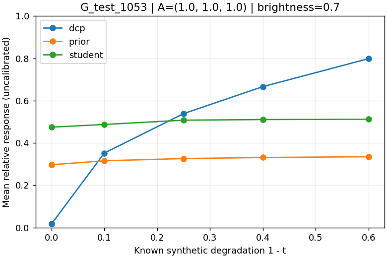
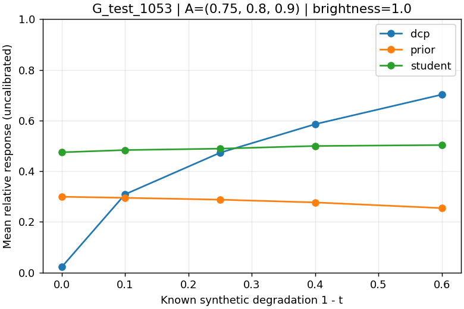
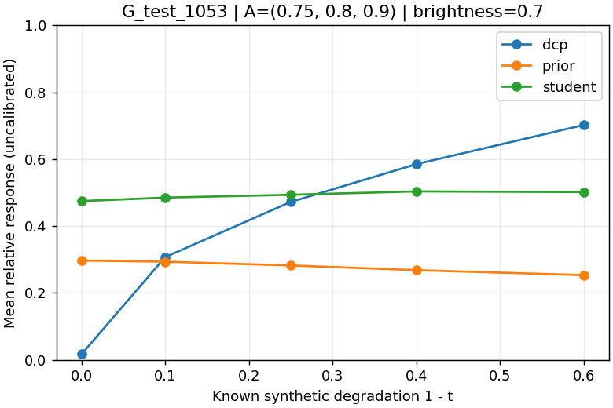
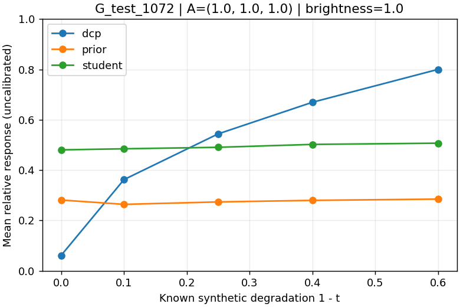
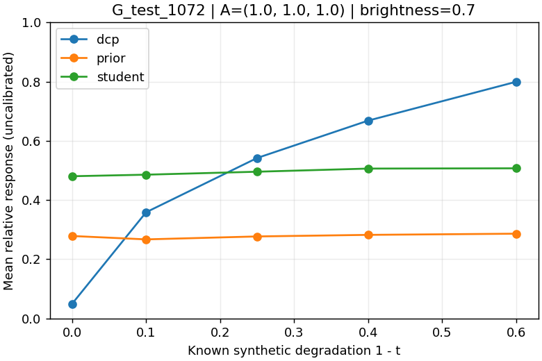
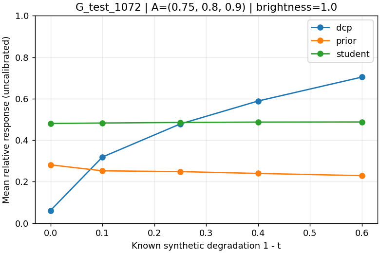
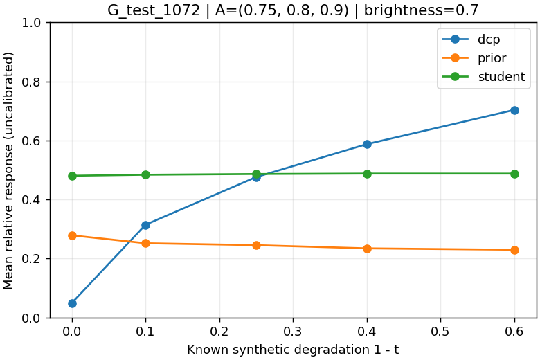
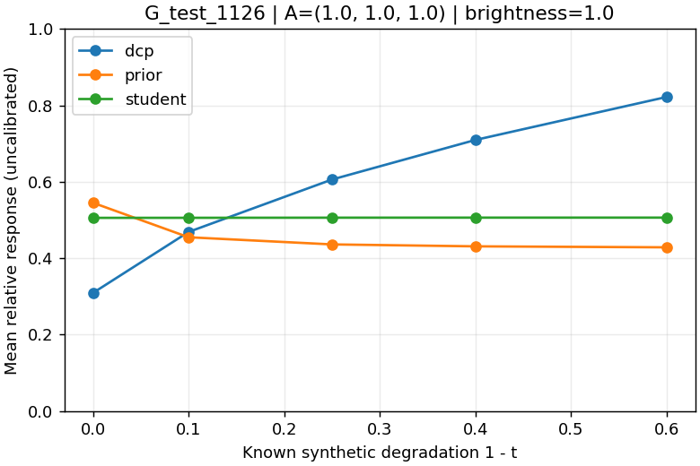
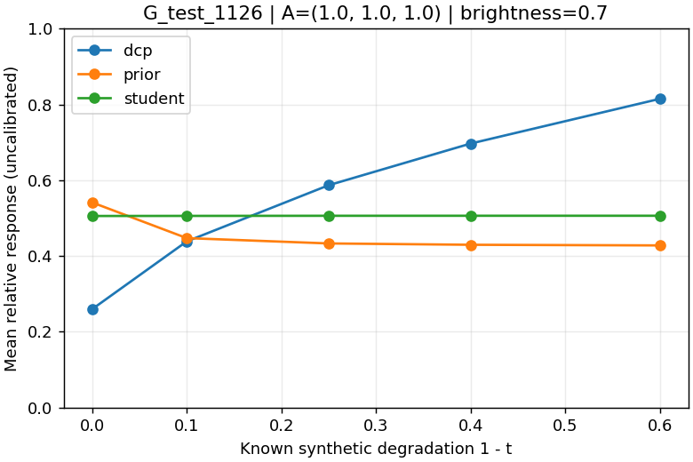
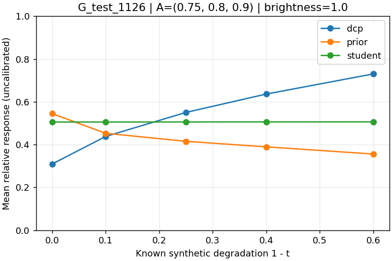
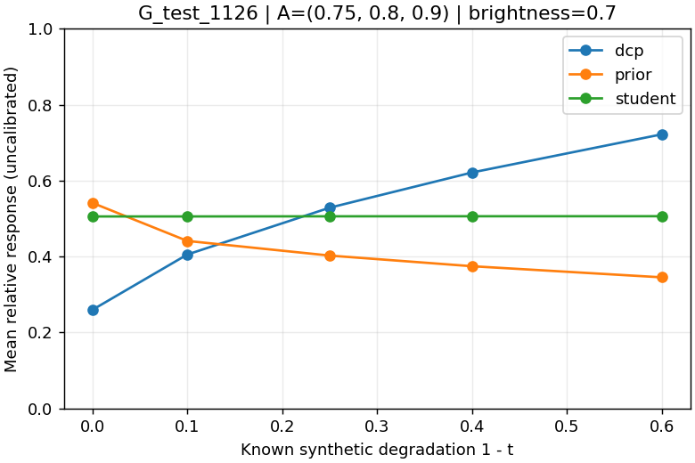
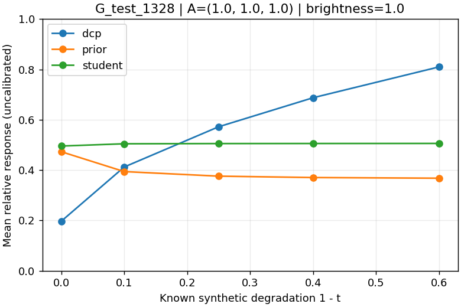
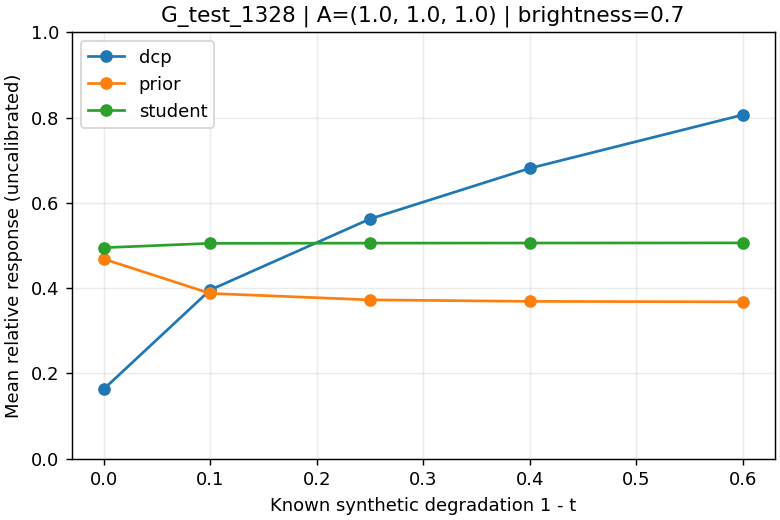
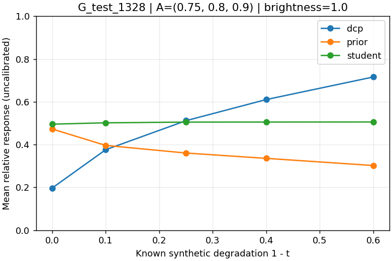
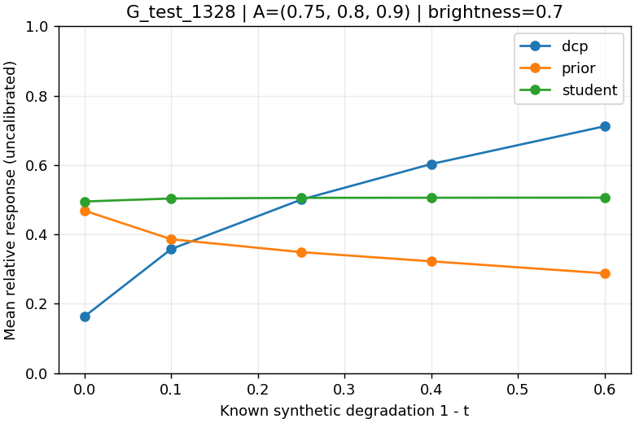

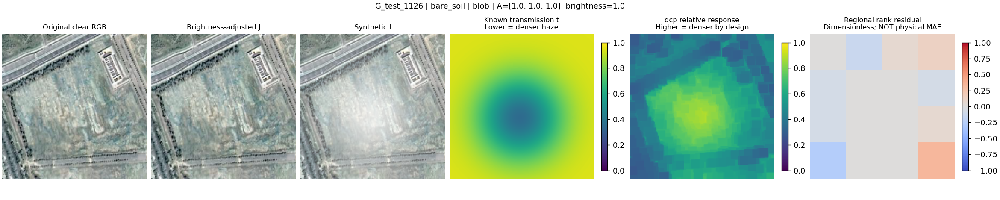
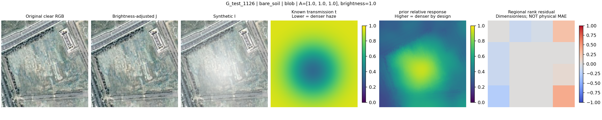
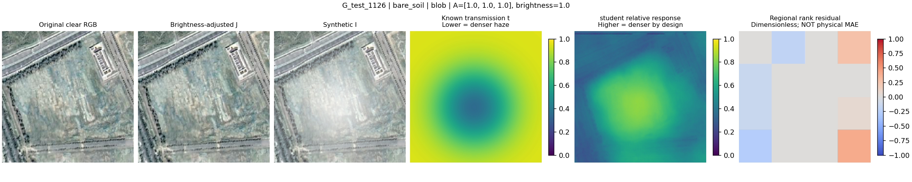
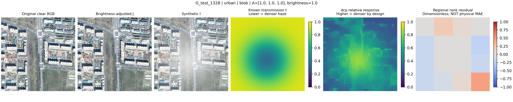
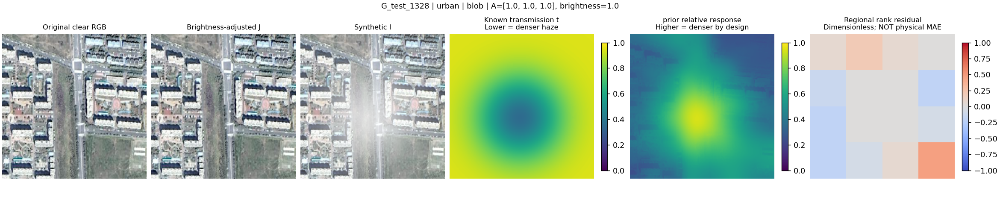
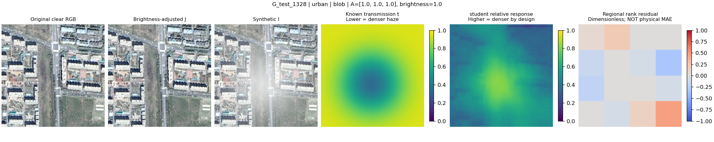
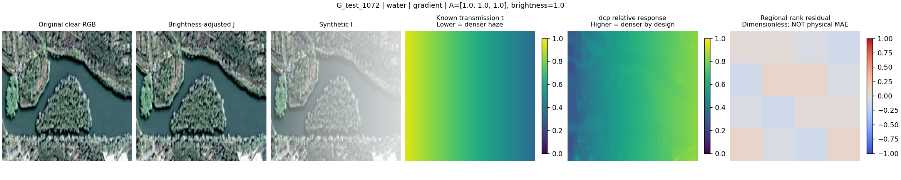
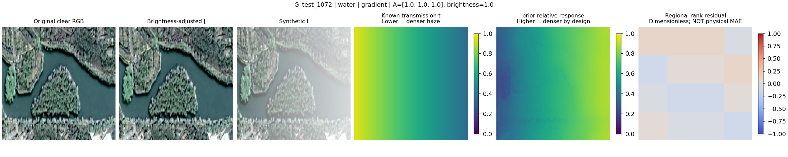
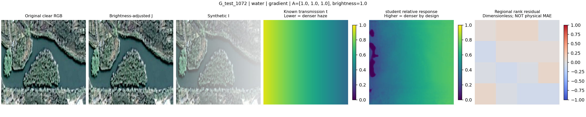
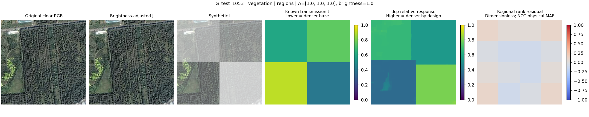
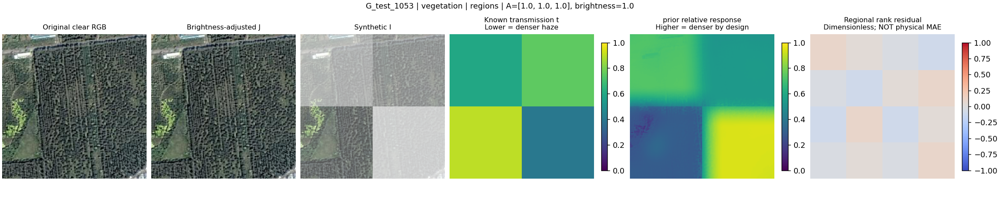
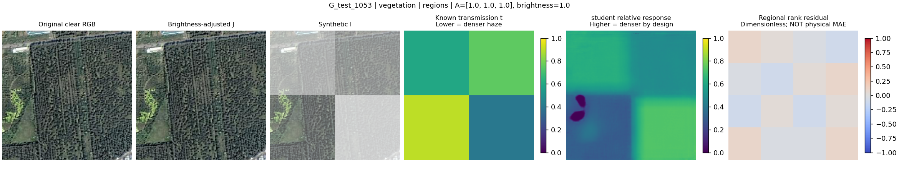

## 结论边界

这些实验只检验给定显示 RGB、合成域、场景和参数下的响应。不能据此宣称得到真实消光系数、真实透射率精度或真实遥感雾场泛化能力。

源码/环境/Git/种子/配置和所有原始数值见 `results.json`；未运行方法不补造结果。
