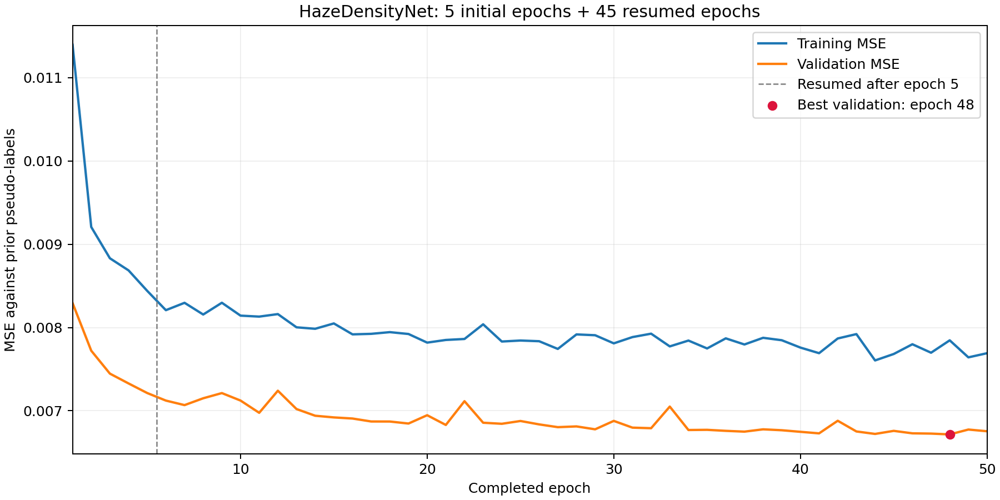

# 累计 50 轮训练结果

完成时间：2026-10-25 21:49:29（Asia/Shanghai）。从第 5 轮 latest.pth 继续训练第 6—50 轮，新增 45 轮，累计 50 轮；保留了前 5 轮原始日志。

[已更新 notebook](../../docs/雾密度网络_最简实验流程.ipynb) 已设置 EPOCHS=50、RESUME=True，训练、验证可视化、测试评估和独立 Benchmark 均已完成，无残留错误输出。

## 训练设置与结果

数据仍为 /mnt/RSHaze+，训练/验证/测试清单保持 6,417 / 713 / 930 张不变。256×256、batch size 4、workers 2、lr=1e-4、AMP 开启、seed=42；沿用 spatial_minmax_valid_boundary_v3。恢复了模型、Adam 优化器、AMP scaler 及最优验证损失。

新增训练用时 80.8 分钟。最优验证结果为第 **48** 轮，MSE **0.006717**，较第 5 轮下降 **6.88%**。latest.pth 为第 50 轮；best.pth 为验证损失最优轮次。

| 轮次 | 训练 MSE | 验证 MSE |
|---:|---:|---:|
| 5 | 0.008440 | 0.007214 |
| 10 | 0.008142 | 0.007123 |
| 20 | 0.007819 | 0.006947 |
| 30 | 0.007810 | 0.006879 |
| 40 | 0.007759 | 0.006748 |
| 48 | 0.007846 | 0.006717 |
| 50 | 0.007692 | 0.006755 |

[完整训练日志](results/train_log.csv)、[固定配置](train_config.yaml)、[固定划分](rshazeplus_split.json)。

## 930 张测试图的最终评估

使用验证集最优权重评估；以下指标是对先验伪标签的拟合误差，不能解释为真实物理雾密度精度。

| 指标 | 第 5 轮模型 | 50 轮训练后的最优模型 |
|---|---:|---:|
| MSE | 0.006821 | 0.006246 |
| MAE | 0.064042 | 0.060457 |
| RMSE | 0.082589 | 0.079034 |
| Pearson | 0.843236 | 0.856893 |

[完整测试报告](test_evaluations/20261025T134216_424091Z/test_metrics.txt)；[验证图](validation_previews/20261025T134154_968685Z/)，6 张；测试可视化本地完整生成 48 张，Git 按每子集文件名字典序保留前 2 张，共 6 张。

## 独立 Benchmark

20 样本最小闭环、128 样本扩展评测及 CPU/GPU 性能测试八个阶段全部 PASS。以下为扩展评测的场景宏平均；PASS 表示执行成功，指标本身反映算法表现。

| 方法 | 雾强度排序准确率 | 空间区域 Spearman | 无雾平均响应 |
|---|---:|---:|---:|
| 暗通道 | 100.00% | 0.9593 | 0.1349 |
| 三先验 | 21.88% | 0.9558 | 0.3980 |
| 训练后的网络 | 77.50% | 0.9556 | 0.4856 |

### 与 5 轮网络的独立评测对比

| 指标 | 第 5 轮模型 | 50 轮训练后的最优模型 |
|---|---:|---:|
| 雾强度排序准确率 | 98.125% | 77.500% |
| 空间区域 Spearman | 0.9532 | 0.9556 |

本次续训表现为伪标签拟合误差下降、独立均匀雾强度排序能力下降、空间相关略升。最终 best.pth 按验证集伪标签 MSE 选择；两个版本的权重和原始评测结果均已保留。

仅覆盖一个地理组的四个 ROI，未核验与训练集的场景内容重叠；不能据此声称跨区域泛化或得到真实物理浓度。

[完整 Benchmark 报告](benchmarks/20261025T134327_753304Z/full_results/report.md)、[CPU/GPU 性能报告](benchmarks/20261025T134327_753304Z/performance/report.md)。

## 权重、历史结果与核验

- [best.pth](checkpoints/best.pth)：第 48 轮；[latest.pth](checkpoints/latest.pth)：第 50 轮，供继续训练使用。
- [5 轮权重与报告备份](snapshots/epoch_005/README.md)，包含独立保留的 best.pth 和 latest.pth。
- [续训执行状态](../notebook_execution/resume_to_50_20261025/status.json)、[完整执行日志](../notebook_execution/resume_to_50_20261025/run.log)、[产物核验](../notebook_execution/resume_to_50_20261025/verification.json)。

当前训练器会在重启时重新设定随机种子，未恢复随机数生成器状态；本次正确恢复了权重、优化器和 AMP，但不保证与一次不中断的 50 轮训练逐位相同。
